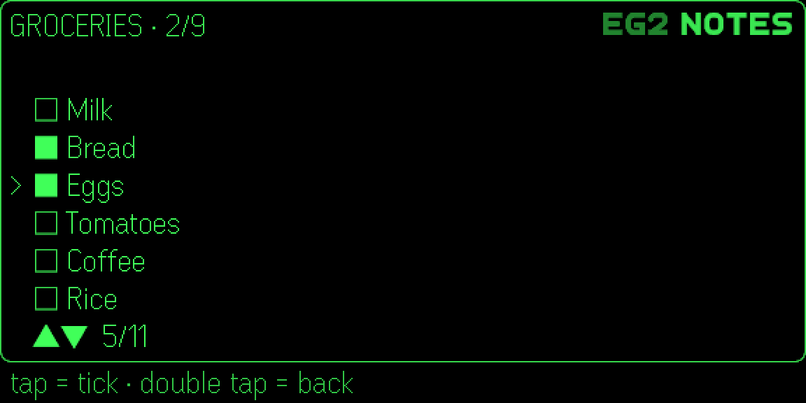
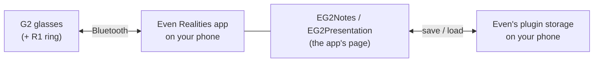
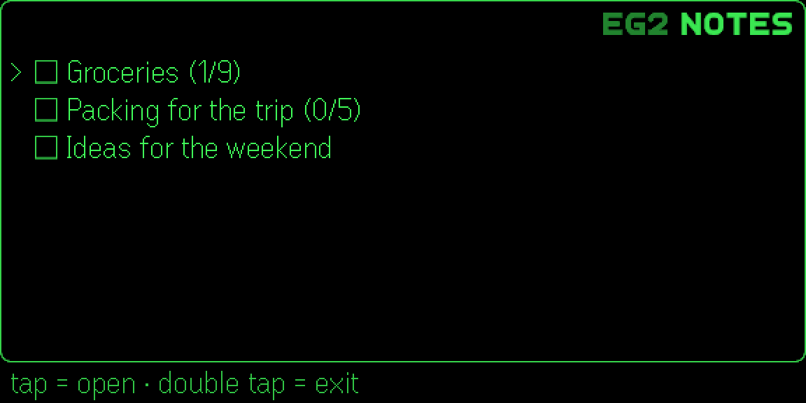
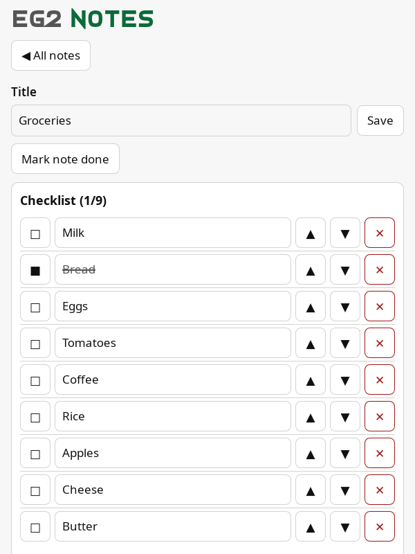
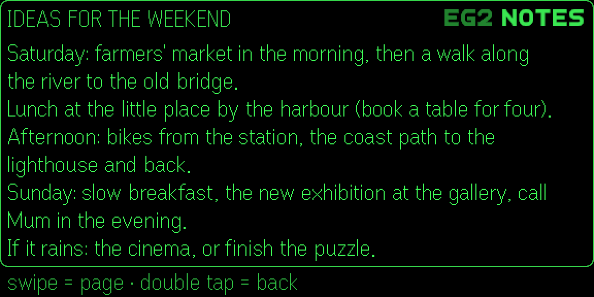
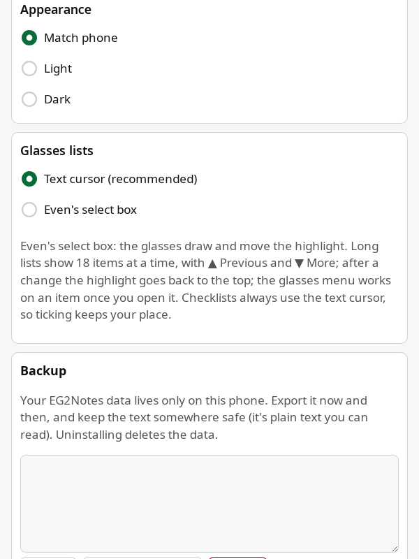
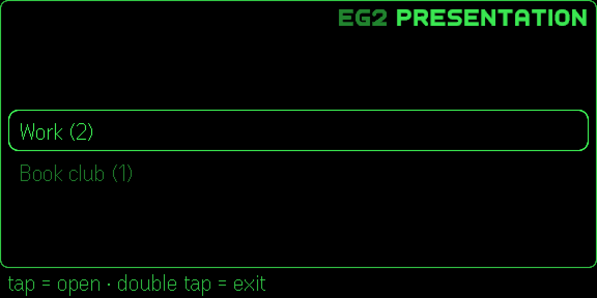
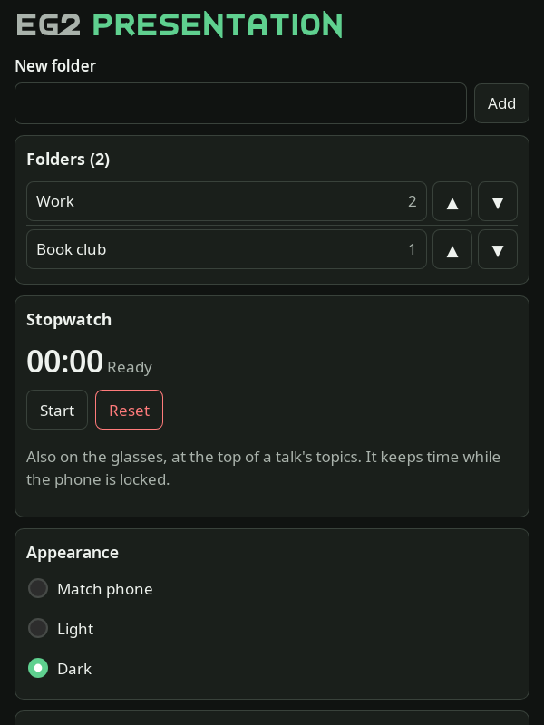

# EG2Apps: EG2Notes and EG2Presentation for Even G2 glasses

Two small, offline apps for **Even Realities G2** glasses, built with the official Even Hub SDK. **EG2Notes** puts your
notes and checklists on the glasses; **EG2Presentation** walks you through your talks topic by topic, with a
stopwatch. You create and edit everything on the phone; the glasses show, tick and move things. No server, no
account, no internet: your data stays on your phone.

> **Get the apps from Even Hub,** inside the Even Realities app on your phone: find **EG2Notes** or
> **EG2Presentation** and tap Install. You don't need anything from this page to use them. This repository is the
> apps' **open-source code**, published so anyone can read how they work and check what they do with your data.
> *(Both apps were submitted to Even Hub on 22 October 2026 and appear there once Even Realities approves them.)*

<p align="center">
  
  <br>
  <em>A checklist in EG2Notes (tap = tick) and a talk in EG2Presentation, with its stopwatch running.</em>
</p>

---

## ✨ Features

- **EG2Notes:** notes with a text and a checklist. On the glasses, open a note, read its text a page at a time, tick
  items with a tap (temple touchpads or the R1 ring), mark notes done.
- **EG2Presentation:** folders of presentations, each an ordered list of topics with your details. On the glasses, a
  tap marks a topic done and shows the next; a talk stopwatch keeps time, even while the phone is locked.
- **The glasses menu:** Move up, Move down, Select and Delete on the row under the cursor; every delete asks first.
- **The phone page:** create, edit, rename, reorder and delete; light or dark (or match the phone).
- **Your choice of lists:** the apps' text cursor, or Even's own select box.
- **Backup:** Export everything as plain text, Import it back.
- **Private by design:** no permissions, no network (`connect-src 'none'`), no analytics, no AI, no speech-to-text.

## 🧭 How it fits together



The app runs inside the Even Realities app on your phone; the glasses show its pages and send your gestures.
Everything is saved on the phone. Nothing goes anywhere else.

## 📋 Requirements

| | |
|---|---|
| **Glasses** | Even Realities G2 (the R1 ring is optional) |
| **Phone** | The Even Realities app, 2.2.10 or later |
| **To build it yourself** | Node.js 24.22.1 or a later 24.x, git; an Even developer account to install your build |

## 🚀 Install

- **To use the apps:** install them from **Even Hub** in the Even Realities app. Nothing to download or build here.
  The guide, with the first start and the settings worth a look: [docs/tutorials/install.md](docs/tutorials/install.md).
- **To read or build the code (optional, for developers):**
  [docs/tutorials/development.md](docs/tutorials/development.md): the checks, Even's simulator, your phone with a QR
  code, packing. In short:

```bash
git clone https://github.com/rod-git-hub/EG2Apps.git
```

```bash
cd EG2Apps && npm ci && npm run check:all
```

```bash
npm run dev:sim -w @eg2apps/eg2notes
```

```bash
node_modules/.bin/evenhub-simulator "http://localhost:5174/?demo"
```

## 📚 Documentation

The docs follow [Diátaxis](https://diataxis.fr/) (tutorials, how-to guides, reference, explanation). The index:
**[docs/README.md](docs/README.md)**.

| Guide | What's in it |
|---|---|
| [docs/tutorials/install.md](docs/tutorials/install.md) | Installing, the first start, updating, uninstalling |
| [docs/tutorials/user-guide.md](docs/tutorials/user-guide.md) | A tour of both apps on the glasses and the phone, with screenshots |
| [docs/tutorials/development.md](docs/tutorials/development.md) | Building and testing it yourself |
| [docs/how-to/features/](docs/how-to/features/README.md) | One user page per feature; the developer pages are in [docs/reference/features/](docs/reference/features) |
| [docs/how-to/maintenance.md](docs/how-to/maintenance.md) | Updates (Even's SDK, packages, Node.js) and releasing |
| [docs/explanation/security-and-privacy.md](docs/explanation/security-and-privacy.md) | Why it's built this way, and what it can't protect |
| [docs/privacy.md](docs/privacy.md) · [docs/terms.md](docs/terms.md) | The privacy policy and terms of use |
| [SECURITY.md](SECURITY.md) | The security design and how to report a problem |

## 🔒 Security and privacy notes

- **No network.** No permissions in `app.json`, and the page's Content Security Policy blocks every connection
  (`connect-src 'none'`). Every build is scanned for network code.
- **Your data stays on your phone,** in the Even Realities app's plugin storage.
- **Be aware:** that storage can be read by **other plugins** installed in the Even Realities app, and by the Even
  Realities app itself (measured on a real phone). Don't keep passwords or other secrets in your notes.
- **No backup:** treat uninstalling as deleting the data. Use **Export** on the phone page to keep a copy.
- **Supply chain:** exact versions, no install scripts, an approved-packages list, a minimum release age, secret
  scanning on every commit ([docs/reference/checks.md](docs/reference/checks.md)).

Details: [privacy policy](docs/privacy.md), [data-flow map](docs/security/data-flow.md),
[residual risks](docs/security/privacy-risk.md).

## 🗂 Project structure

```
apps/eg2notes/         EG2Notes: data model, glasses screens, phone page, app.json (Vite + TypeScript)
apps/eg2presentation/  EG2Presentation: the same, plus the stopwatch
packages/shared/       code both apps use: glasses page and navigation, glasses menu, storage, text fitting,
                       phone page helpers, the Content Security Policy
scripts/               checks (secret scan, hygiene, approved packages, bundle scan, release age, history scan),
                       icons, documentation screenshots
tests/                 node:test suites, run by `npm test`
docs/                  tutorials, how-to guides, reference, explanation (index: docs/README.md); docs/img the screenshots
```

## 🧪 Tested with

Even G2 glasses and the R1 ring with the latest Even Realities app and firmware (Android); Even Hub SDK 0.0.16, CLI
0.1.14 and simulator 0.9.5; Node.js 24.22 on Linux x86-64.

## 📸 Screenshots

All screenshots use made-up data, taken in Even's simulator ([docs/how-to/screenshots.md](docs/how-to/screenshots.md)).

| Glasses | Phone |
|---|---|
|  |  |
|  |  |
|  |  |
|  |  |

More in [docs/tutorials/user-guide.md](docs/tutorials/user-guide.md).

## Status

Version 1.0.1 of both apps was submitted to Even Hub for review on 22 October 2026; once approved, install them from
Even Hub. Changes: [CHANGELOG.md](CHANGELOG.md).

## License

Apache License 2.0: see [LICENSE](LICENSE) and [NOTICE](NOTICE). Made by Rod. Not affiliated with Even Realities.
