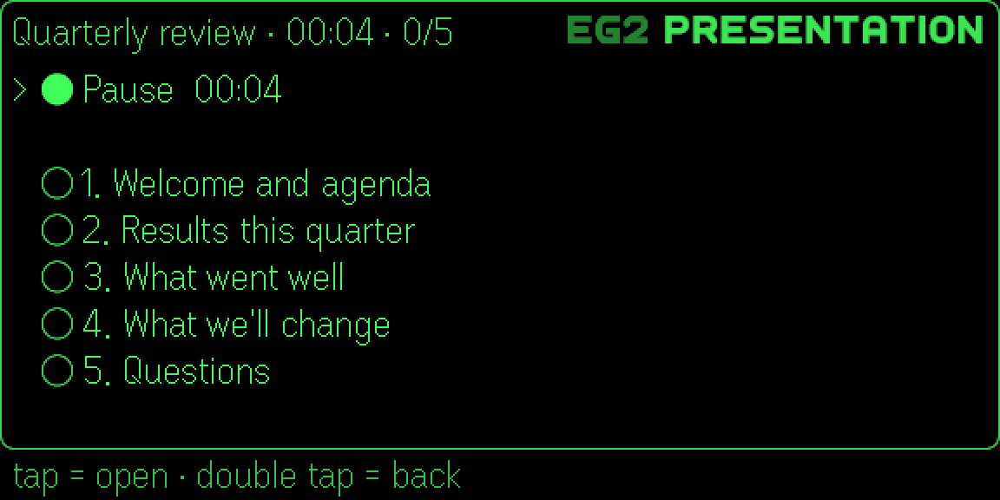
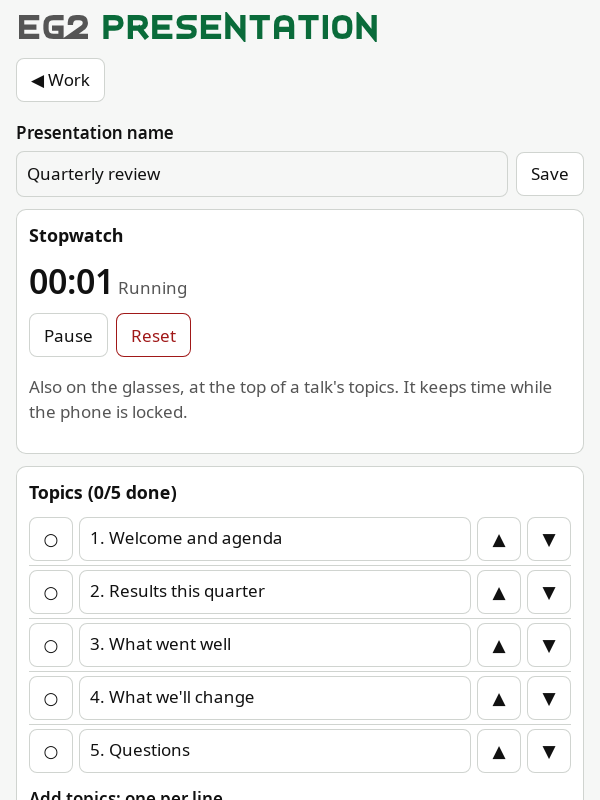
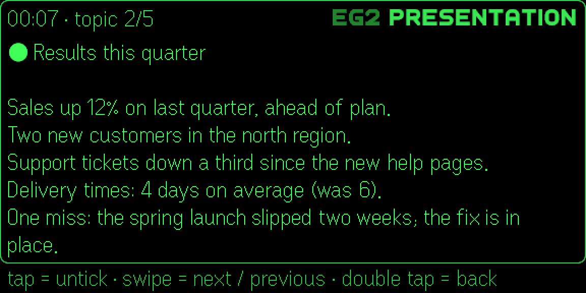
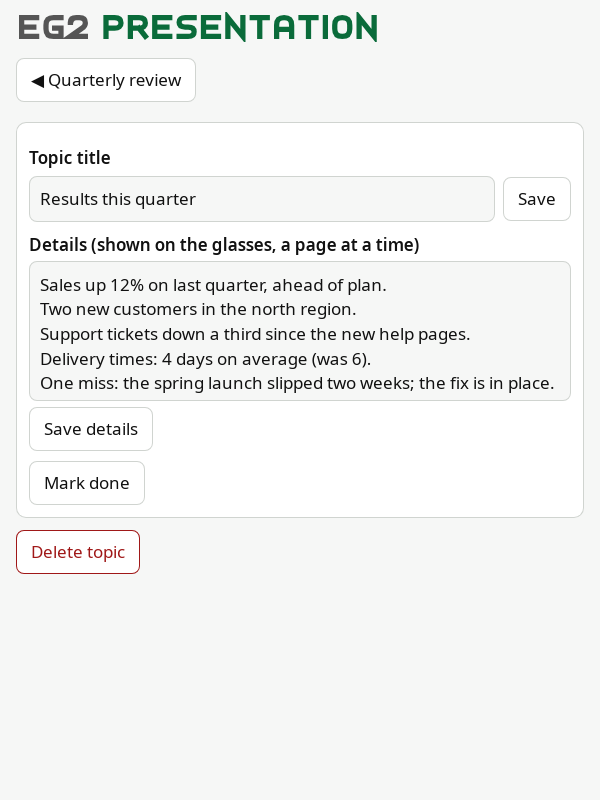

# EG2Presentation (user guide)

Folders of presentations. A presentation is an ordered list of topics, each with details you read on the glasses while
you talk, and a stopwatch. Created and edited on the phone; on the glasses you go through the topics.

| Glasses | Phone |
|---|---|
|  |  |
|  |  |

## On the glasses

- **Folders** → **presentations** (with topics done/total) → **topics**.
- **A presentation:** the stopwatch row at the top, then its topics: `○` not yet, `●` done, numbered. The header shows
  the name, the stopwatch and topics done (`Quarterly review · 00:04 · 0/5`).
- **The stopwatch:** **▶ Start stopwatch**; while running **● Pause** (with the time); when paused **▶ Resume** and
  **○ Reset stopwatch**. It keeps time while the phone is locked or the app is in the background.
- **A topic:** its title, then its details, a page at a time. The header shows the stopwatch and `topic 2/5`.
  - **Tap = tick / untick:** marks the topic `●` (done) or back to `○`, and you stay on it.
  - **Swipe down** past the last page: the next topic; **swipe up** on the first page: the previous one. A long text
    turns its pages first. Swiping never ticks; nothing happens past the first or last topic.
  - Double tap: back to the topics, with the cursor on the topic you reached.
  - The line under the frame says what a tap does now: `tap = tick` or `tap = untick`.
- **Glasses menu** (tap, then press and hold): Move up, Move down, Select and Delete on folders, presentations and
  topics; on a topic's page, for that topic. Deleting a folder or presentation says what's inside and deletes it too.
  See [glasses-menu.md](glasses-menu.md).

With Even's select box ([settings.md](settings.md)) the stopwatch row says "stopwatch" and the time is in the header:
Even's list can't change a row in place.

## On the phone

- **Folders:** **New folder** → Add; open, ▲ ▼ to move. In a folder: **Folder name** → Save, **New presentation**,
  the presentations (open, ▲ ▼), **Delete folder** (tap twice: deletes everything in it).
- **A presentation:** **Presentation name** → Save; the **Stopwatch** (Start / Pause / Resume, Reset); **Topics**:
  `○` / `●` to mark done, tap a title to edit it, ▲ ▼ to move; **Add topics: one per line**; **Reset done** (every
  topic back to `○`, ready for the next talk); **Delete presentation**.
- **A topic:** **Topic title** → Save, **Details** → Save details (shown on the glasses a page at a time),
  **Mark done / not done**, **Delete topic**.
- The **Stopwatch** card on the first page is the same stopwatch as on the glasses.

## Your data

Saved on your phone only, in the Even Realities app's plugin storage. The stopwatch is saved there too (when it
started, time so far). Keep a copy with **Backup → Export** ([settings.md](settings.md)).

Limits: 100 folders, 100 presentations a folder, 200 topics a presentation; names up to 200 characters, details up to
10,000.
