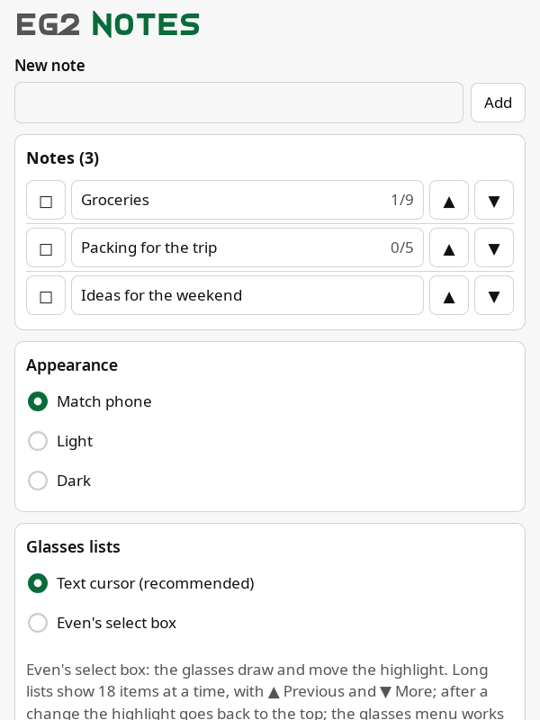
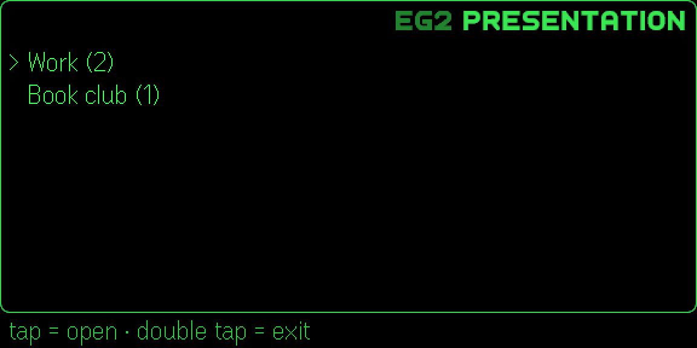
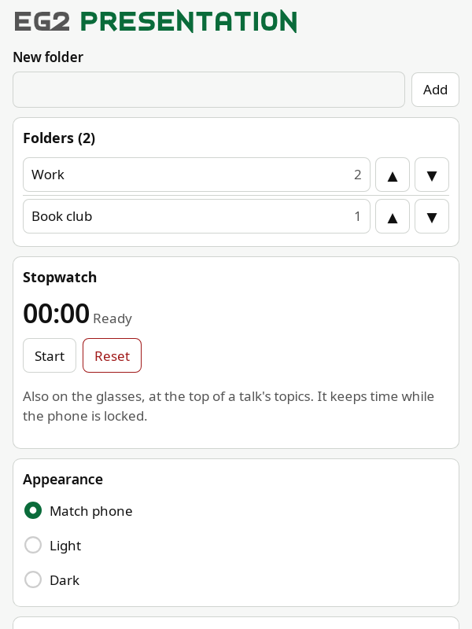

# Installing EG2Notes and EG2Presentation

How to get the apps onto your phone and glasses, and what you see the first time. Building them yourself is in
[development.md](development.md). All screenshots use made-up data.

## Contents

1. [What you need](#1-what-you-need)
2. [Install](#2-install)
3. [First start](#3-first-start)
4. [Settings worth a look](#4-settings-worth-a-look)
5. [Updating](#5-updating)
6. [Uninstalling](#6-uninstalling)

## 1. What you need

| | |
|---|---|
| **Glasses** | Even Realities G2, paired with the Even Realities app on your phone |
| **Phone** | The Even Realities app, version 2.2.10 or later (tested on Android) |
| **Optional** | The R1 ring: it does the same as the temple touchpads |
| **Nothing else** | No account, no server, no internet connection: the apps work offline |

## 2. Install

**From Even Hub:** once the apps are published, find **EG2Notes** or **EG2Presentation** in Even Hub, inside the Even
Realities app, and install it. (Status: in review; this section gets its screenshots when they're live.)

**As a beta tester:** the developer invites your Even account's email. Even's steps
([Beta testing](https://hub.evenrealities.com/docs/test/beta-testing)): accept the invitation email, then in the Even
Realities app go to "**Me → Beta tester**", which lists the build, and tap **Install**.

**Your own build:** see [development.md](development.md) (a QR code for testing, or a private build).

## 3. First start

Open the app from your glasses' app menu. In the Even Realities app on your phone, opening the app shows its **phone
page**: that's where you create and edit everything. The glasses show, tick and move things.

With nothing saved yet, each app says so and points you to the phone ("No notes yet. Add one on your phone."): never a
blank screen. Add a note or a folder on the phone, and it appears on the glasses at once.

| Glasses | Phone page |
|---|---|
|  |  |
|  |  |

The gestures are on the line under the frame of every glasses page (for example "tap = open · double tap = exit").
On the first page, a double tap opens Even's exit dialog. The full tour: [user-guide.md](user-guide.md).

## 4. Settings worth a look

Further down each phone page:

- **Appearance:** Match phone (default), Light or Dark.
- **Glasses lists:** the app's text cursor (recommended) or Even's own select box. Details in
  [how-to/features/settings.md](../how-to/features/settings.md).
- **Backup:** Export gives you all your data as text to keep. There's no other copy anywhere.

**R1 ring:** keep the ring's **low power mode off**. With it on, about one flick in ten doesn't reach the app (measured).

## 5. Updating

Install the new version the same way you installed the first. For beta or private builds, delete the older build of
the same app on the phone first. **Export before you update** (phone page → Backup → Export): it costs a few seconds,
and Import brings everything back if the update doesn't keep it.

## 6. Uninstalling

Treat uninstalling as deleting the app's data: **export first** if you want to keep it, and save the text somewhere
safe. Import brings it back later.
