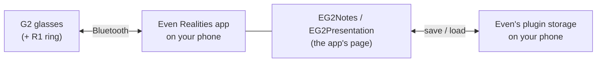
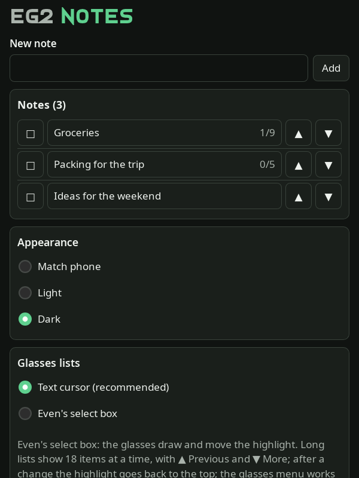
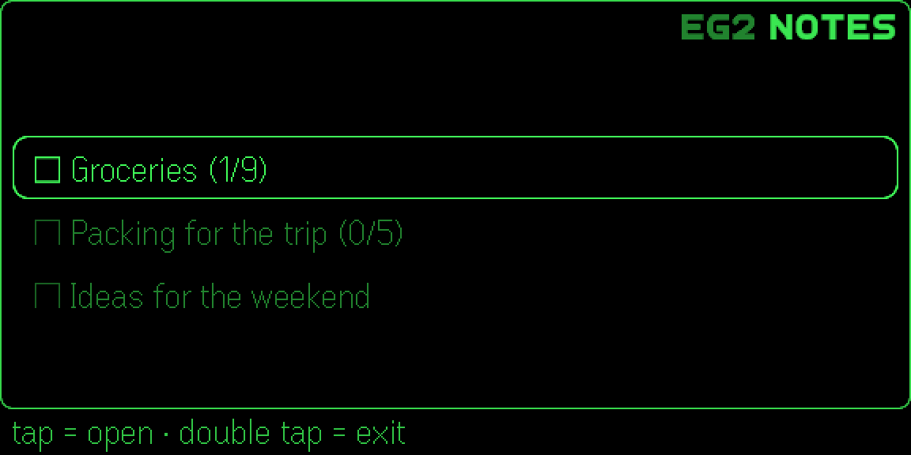
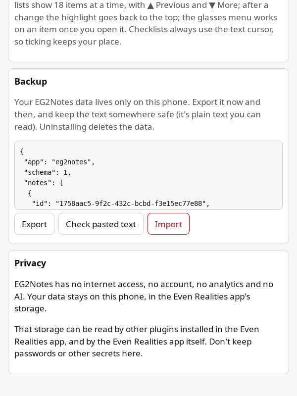

# Using EG2Notes and EG2Presentation

A tour of both apps on the glasses and the phone. Each section links to the feature's page in
[how-to/features/](../how-to/features/README.md). Installing: [install.md](install.md). All screenshots use made-up data.

## Contents

1. [How it fits together](#1-how-it-fits-together)
2. [Gestures](#2-gestures)
3. [The glasses menu](#3-the-glasses-menu)
4. [EG2Notes](#4-eg2notes)
5. [EG2Presentation](#5-eg2presentation)
6. [The phone page](#6-the-phone-page)
7. [Backup](#7-backup)
8. [Good to know](#8-good-to-know)

## 1. How it fits together

The app runs inside the Even Realities app on your phone. The glasses show its pages and send your taps and swipes.
Everything is saved on your phone, nowhere else: there's no server and no internet connection.

## 2. Gestures

The temple touchpads and the R1 ring do the same things:

| Gesture | What it does |
|---|---|
| **Swipe** up / down | Moves the `>` cursor; past the last row it wraps to the first. On a text page: the next or previous page |
| **Tap** | Opens or does the row under the cursor (a checklist item: ticks it) |
| **Double tap** | Back one page. On the first page: Even's exit dialog |
| **Tap, then press and hold** | The glasses menu (Even's): see below |

Every page shows its gestures on the line under the frame ("tap = tick · double tap = back"), so you needn't remember
them. Each app's name sits small in the top-right corner.

## 3. The glasses menu

**Tap, then press and hold** on a list: Even's glasses menu shows **Move up**, **Move down**, **Select** and
**Delete** for the row under the cursor. On an opened item (a note's text, a topic's details) it offers Move up, Move
down and Delete for that item.

- **Delete** always asks first and says what goes with it ("5 checklist items will be deleted too"). Tap = delete,
  double tap = cancel. There is no undo.
- **Select** marks several rows (★ selected, ☆ not): tap rows to mark them, then **Delete N selected** at the top (one
  confirmation) or **Cancel**.

Details: [how-to/features/glasses-menu.md](../how-to/features/glasses-menu.md).

## 4. EG2Notes

Notes with an optional text and an optional checklist.

| Glasses | Phone |
|---|---|
|  |  |
|  |  |

- **The list:** `■` done, `□` open, and ticked/total items, e.g. `□ Groceries (1/9)`.
- **A note:** **≡ Note text** (if it has text), **● Mark note done / open**, then its checklist. **Tap an item to
  tick or untick it**; the cursor stays where it is. The header shows ticked/total.
- **Note text:** a page at a time; swipe for the next page.

More: [how-to/features/eg2notes.md](../how-to/features/eg2notes.md).

## 5. EG2Presentation

Folders of presentations; a presentation is an ordered list of topics, each with details, and a stopwatch.

| Glasses | Phone |
|---|---|
|  |  |
|  |  |
|  |  |

- **Folders → presentations → topics.** The header shows where you are: `[Work]`, then the presentation's name, the
  stopwatch and topics done (`Quarterly review · 00:04 · 0/5`).
- **The stopwatch** is at the top of every presentation's topics: **▶ Start**, **● Pause**, **▶ Resume**,
  **○ Reset**. It keeps time while the phone is locked, and the phone page shows the same stopwatch.
- **A topic's details:** tap = **done ▶ next** (marks it `●` and opens the next topic). Swiping down past the last
  page also moves on. Double tap = back to the topics.

More: [how-to/features/eg2presentation.md](../how-to/features/eg2presentation.md).

## 6. The phone page

In the Even Realities app, open the app to see its phone page. **All creating and editing happens here:** add,
rename, reorder (▲ ▼), tick, delete, write a note's text or a topic's details. Every change shows on the glasses at
once.

Further down: **Appearance** (Match phone, Light, Dark), **Glasses lists** (the text cursor or Even's select box),
**Backup** and a short **Privacy** note.

| Settings | Dark |
|---|---|
|  |  |

With **Even's select box**, the glasses draw the list and move the highlight themselves:

More: [how-to/features/settings.md](../how-to/features/settings.md).

## 7. Backup

There's no server, so the only copy of your data is on your phone. **Backup → Export** shows it all as plain text:
copy it and keep it somewhere safe. **Import** checks pasted text, says what it holds ("3 notes with 14 checklist
items"), and replaces everything after a second tap.

## 8. Good to know

- **Other plugins can read the storage.** The Even Realities app's plugin storage can be read by other plugins you
  install, and by the Even Realities app itself. Don't keep passwords or other secrets in your notes or talks.
- **No undo.** Deletes ask first; Export is the safety net.
- **R1 ring:** keep its low power mode off (with it on, about one flick in ten is lost).
- **Limits:** EG2Notes holds up to 500 notes of up to 200 checklist items; EG2Presentation up to 100 folders of 100
  presentations of 200 topics. Names up to 200 characters; a note's text or a topic's details up to 10,000.
- **Privacy:** [privacy policy](../privacy.md) · [security and privacy, explained](../explanation/security-and-privacy.md).
